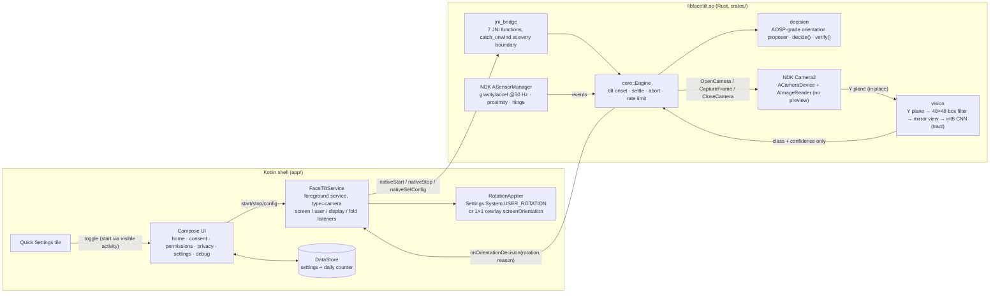

# allAround

**Face-aware auto-rotate for Android.** The screen follows the orientation of *your head*, not only gravity, so lying on your side no longer flips the phone to landscape. It does what Pixel's "Auto-rotate with Face Detection" does, as an ordinary installable app.

> **Naming.** The app is called **allAround** (launcher, notification, in-app title, Play title). The application ID `dev.facetilt` and the internal crate and package names `facetilt-*` / `dev.facetilt.*` are unchanged. See [Naming](#naming).

| | |
|---|---|
| Platform | Android 10+ (min SDK 29), target / compile SDK 36 |
| Languages | Rust (core), Kotlin + Jetpack Compose (shell), Python / PyTorch (training) |
| Version | 1.0.1 (versionCode 2) |
| Model | 34,933-parameter int8 CNN, 47 KB, 48×48 grayscale input, runs on-device in about 1 ms |
| Network | **None.** The app has no `INTERNET` permission, and the build fails if one appears |
| Licence | Apache-2.0 (model weights derived from CC BY 4.0 data, see [Licence](#licence)) |

> ### Status: read this first
> Everything in this repository builds, and its automated tests pass. **The app has never been run on a physical phone or an emulator** (the build machine had no device and no KVM). The camera and sensor code is compiled and linted against the real NDK headers for arm64 and armv7. The state machine is tested against synthetic sensor traces with a simulated camera, and the model is evaluated on *simulated* camera frames. **On-device latency, battery use and real-camera accuracy are unmeasured.** Instrumentation to measure them is built in (see [Latency](#latency) and [docs/BATTERY_AND_PERFETTO.md](docs/BATTERY_AND_PERFETTO.md)). Test on a real phone before relying on it or publishing it widely.

---

## Contents
1. [What it does](#what-it-does) · 2. [Features and settings](#features-and-settings) · 3. [Get the app](#get-the-app) · 4. [How it works](#how-it-works) · 5. [Repository layout](#repository-layout) · 6. [Building from source](#building-from-source) · 7. [Tests and checks](#tests-and-checks) · 8. [The model](#the-model) · 9. [Latency](#latency) · 10. [Battery](#battery) · 11. [Privacy](#privacy) · 12. [Android version behaviour](#android-version-behaviour) · 13. [Limitations vs the built-in Pixel feature](#limitations-vs-the-built-in-pixel-feature) · 14. [Known gaps](#known-gaps) · 15. [Publishing to Google Play](#publishing-to-google-play) · 16. [Documentation index](#documentation-index) · 17. [Naming](#naming) · 18. [Licence](#licence)

---

## What it does

Stock auto-rotate only reads gravity. Lie on your side with the phone in portrait relative to your face, and gravity says "the phone is sideways", so the screen flips to landscape even though your head is sideways too.

allAround adds the missing piece:

1. When you start rotating the phone, it opens the **front camera for a fraction of a second** (typically under 0.4 s). There is no preview.
2. One frame's brightness channel is shrunk **in memory** to a **48 × 48 black-and-white thumbnail**.
3. A tiny on-device model answers one question: *which way is the head turned relative to the phone?* (up, left, right, upside down, or no face).
4. The thumbnail is erased and the camera closes.
5. The screen rotates **only if your head turned with the phone**. If you are lying on your side, portrait stays.

If the camera is unavailable, blocked, or the model is unsure, the phone falls back to **normal gravity auto-rotate**. It never gets stuck.

## Features and settings

* **Off by default.** A short consent screen explains the camera use before anything is enabled.
* **Master switch** on the home screen, a **Quick Settings tile** ("Face detection"), and a **Pause** button in the notification.
* **Settings**
  * **Only intervene when lying down.** Android's own auto-rotate stays on. The app steps in only to hold portrait when it sees you are lying on your side, and hands auto-rotate straight back when you sit up.
  * **2nd verification.** After the screen turns to landscape, it looks once more when the phone is held still and switches back to portrait if you are lying down.
  * **Allow upside-down.**
  * **Advanced:** rotation method (system setting, or an invisible overlay window), face-confidence threshold (default 0.70), and start after reboot.
* **Privacy screen:** permission states, camera uses today, and **Delete all data**.
* **Debug screen** (debug builds only): per-stage latency, camera-on seconds per hour, activations per hour and inference p50/p95.

## Get the app

| Option | How |
|---|---|
| **Google Play** | Not published yet. See [Publishing to Google Play](#publishing-to-google-play) |
| **Test APK** | Build `./gradlew assembleRelease` (signed if you provide a keystore) or `assembleDebug`, then `adb install app/build/outputs/apk/.../*.apk`. Allow "install unknown apps" if sideloading by hand |
| **Build from source** | [Building from source](#building-from-source) |

First run: open the app → read the consent → turn the switch on → allow the camera → allow *Modify system settings* (or choose the overlay method and allow *Display over other apps*). Android's green camera indicator flashes briefly on every rotation, which is expected and cannot be hidden.

---

## How it works



The Rust core owns everything latency-critical: sensors, the trigger state machine, camera capture, downsampling, inference and the decision. The Kotlin shell owns only what Android requires from the Java layer: permissions, the camera foreground service, the tile, the rotation applier, UI and settings. Only a small integer enum crosses JNI, never image data.

One activation (timings from the simulated mid-range camera model, see [Latency](#latency)):

```mermaid
sequenceDiagram
    participant S as Gravity sensor (50 Hz)
    participant E as Engine (Rust thread, ALooper)
    participant C as Camera worker + AImageReader callback
    participant V as Vision (callback thread)
    participant K as Kotlin service
    S->>E: angle vs last stable > 15°, still moving (t = 0)
    E->>C: OpenCamera (pre-warm, no preview)
    C-->>E: CameraOpened (about 110 ms; frames stream, auto-exposure converges, frames dropped unread)
    S->>E: gravity enters the new orientation band
    E->>C: CaptureFrame
    C->>V: next frame: box-filter Y plane → 2.3 KB stack thumbnail, zero camera buffer, release AImage
    V->>V: mirror view → int8 CNN (about 1 ms) → zero thumbnail
    V-->>E: FrameClassified{class, confidence}
    E->>E: decide(gravity, head, confidence)
    E->>C: CloseCamera
    E->>K: onOrientationDecision(rotation, reason)
    K->>K: apply rotation, report apply time
```

### 1. Low-lag trigger (`crates/core/src/engine.rs`)

* Gravity (`TYPE_GRAVITY`, falling back to the raw accelerometer) at `SENSOR_DELAY_GAME`, registered only while the screen is on **and** unlocked. The engine keeps a low-pass-filtered vector (τ = 40 ms) and an angular-speed estimate (τ = 60 ms) for onset detection.
* **Pre-warm at onset:** the angle between the filtered vector and the last stable one exceeds 15°, angular speed exceeds 25 °/s, and the in-plane change exceeds 10° (pitch-only motions such as picking the phone up can never change orientation). The camera opens immediately, without waiting for the tilt to finish. The repeating request lets auto-exposure converge, and frames are released unread.
* **Capture:** when the proposed orientation reaches a *new* band, or after 120 ms of stability, the next frame is classified, a decision is made, and the camera closes.
* **Abort:** the tilt falls back more than 12° from its peak without reaching a new orientation, or nothing settles within 1.5 s. The camera closes and everything is discarded. A 700 ms capture timeout falls back to gravity.
* **Rate limit:** at least 800 ms between opens, with doubling backoff (up to 8 s) on wasted opens and flapping, relaxed by useful decisions and reset after 15 s of quiet.
* **Camera skipped when:** the device is flat or overhead, the proximity sensor is covered, a foldable is half-folded (hinge 30° to 150°), the change is a small drift, the motion heads back to the orientation already shown, a cooldown is active, gravity already matches the current orientation, or the face already judged this proposal (for example you are still lying down). A slow rotation that never looks like an onset is evaluated once at rest.

### 2. AOSP-grade gravity proposal (`crates/decision/src/proposer.rs`)

The gravity side is a Rust port of Android's `WindowOrientationListener` (the logic stock Android, and therefore Pixel, builds on), using AOSP's constants. Compared with a naive "nearest quarter-turn" rule it adds:

* an **adaptive low-pass filter** (reset after a gap longer than 1 s);
* **overhead detection:** with the screen facing the floor (tilt at or below −40°, exit at −15°), orientation is indeterminate and no rotation is proposed. This is the "lying on your back with the phone over your face" case;
* **per-orientation tilt tolerance:** a rotation is only proposed when the phone is close enough to vertical, with stricter limits for unnatural orientations (upside-down hardest: 60° vs 70° for portrait);
* a **22.5° hysteresis dead-zone** around 45°, so the orientation does not flip-flop (the 45° oscillation scenario went from 2 spurious flips to 0);
* **flat, swing (pick-up) and acceleration detection** with settle delays.

The filter constant is 90 ms instead of AOSP's 200 ms. The pre-warmed camera confirms the result, so a little smoothing can be traded for latency.

### 3. Decision (`crates/decision`)

`decide(current, gravity, head, confidence)`:

| Situation | Result |
|---|---|
| Gravity already matches the current orientation | no change |
| No usable frame, no face, or confidence below 0.70 | follow gravity (normal auto-rotate) |
| Head matches the *new* gravity orientation | rotate |
| Head matches the *current* orientation (lying on your side) | **keep** |
| Head matches neither | follow gravity |

Changes start a 600 ms cooldown. Upside-down follows the stock phone default (off, configurable). `verify()` implements the optional **2nd verification**: only a confident face aligned with the previous orientation can revert a change, and the second look can never invent one.

**Assist mode** ("only intervene when lying down") seizes rotation control at the tilt onset (about 15°, before the system flips at about 45°), holds portrait if the face says you are lying down, and releases control straight back (re-enabling system auto-rotate) otherwise. "Sat back up" is detected from gravity alone, with no extra camera use.

### 4. Image path (`crates/jni_bridge/src/android/camera.rs`, `crates/vision`)

The camera uses the smallest supported `YUV_420_888` stream (preferring a short side of at least 128 px) and an `AImageReader` only. In the reader callback:

1. The Y plane is box-filtered, in place, from a centred square into a 2,304-byte stack buffer (the crop rectangle and row stride are honoured).
2. Every plane of the camera buffer is zeroed (the reader is created with CPU-write usage; devices that refuse it fall back to read-only buffers, which are released immediately after the in-place downsample).
3. The `AImage` is released **before** any inference.
4. The thumbnail is rotated and mirrored into the classifier's frame, using the camera sensor orientation.
5. The int8 model runs, then the thumbnail and the normalised tensor are zeroed.
6. Only `(class, confidence)` goes to the engine.

Near-uniform frames (lens covered, camera privacy toggle) are reported as unusable and fall back to gravity.

---

## Repository layout

| Path | Contents |
|---|---|
| `crates/decision` | Pure decision rule, AOSP-grade orientation proposer, 2nd-verification rule, cooldown. No I/O, no `unsafe` |
| `crates/core` | Tilt-trigger / capture / decide state machine (`Engine`), rate limiter with backoff, metrics. No `unsafe`. `tests/` replays sensor traces against a simulated camera |
| `crates/vision` | Box filter, sensor-orientation and mirror transform, standardisation, int8 classifier on [tract](https://github.com/sonos/tract) (model embedded). No `unsafe` |
| `crates/jni_bridge` | `libfacetilt.so`: JNI exports, NDK sensors, NDK Camera2 capture, engine and camera threads. All `unsafe` lives here, each block with a `SAFETY:` comment (`clippy::undocumented_unsafe_blocks = deny`) |
| `app/` | Kotlin shell: Compose UI, foreground service, tile, rotation appliers, DataStore |
| `training/` | PyTorch pipeline, model card, data licences, evaluation reports |
| `tools/gen_traces.py`, `crates/core/tests/traces/` | Synthetic sensor-trace generator and the traces |
| `scripts/` | APK permission check, dependency audit, trace recorder |
| `docs/` | Battery Historian / Perfetto guide, Play release checklist, Play Console answers |
| `.github/workflows/ci.yml` | CI (fmt, clippy on host and Android, tests, `cargo deny`, Gradle build, instrumented test) |

---

## Building from source

### Prerequisites

| Tool | Version used | Notes |
|---|---|---|
| Rust | stable ≥ 1.91 | `rustup target add aarch64-linux-android armv7-linux-androideabi` |
| cargo-ndk | 4.x | `cargo install cargo-ndk --locked` |
| Android NDK | r27c (`27.2.12479018`) | `sdkmanager "ndk;27.2.12479018"`. Gradle passes its path to cargo-ndk |
| Android SDK | platform 36, build-tools 35 | compile and target SDK are 36 |
| JDK | 17+ | |

`ANDROID_HOME` (or `local.properties` with `sdk.dir=...`) must point to the SDK.

### One command

```bash
./gradlew assembleDebug
```

`preBuild` runs `cargo ndk -t arm64-v8a -t armeabi-v7a -P 29 build --release -p facetilt-jni` into `app/build/rustJniLibs`, then Gradle packages it. Options (`gradle.properties` or `-P`):

* `facetilt.abis=arm64-v8a` builds fewer ABIs (add `x86_64` for an emulator).
* `facetilt.rustProfile=debug` makes Rust builds faster.

Every variant also runs `check<Variant>NoNetworkPermissions`, which fails the build if the merged manifest (including all libraries) requests `INTERNET` or any other network permission.

### Release build (Play bundle)

```bash
./gradlew bundleRelease     # app/build/outputs/bundle/release/app-release.aab
./gradlew assembleRelease   # installable APK, for testing the minified build
```

Release builds are signed from `keystore.properties` (git-ignored; see [Publishing to Google Play](#publishing-to-google-play)). Without it, they are unsigned.

---

## Tests and checks

```bash
cargo test --workspace                                      # 107 Rust tests
cargo clippy --workspace --all-targets -- -D warnings       # host
cargo ndk -t arm64-v8a   -P 29 clippy -p facetilt-jni --all-targets -- -D warnings   # real NDK code
cargo ndk -t armeabi-v7a -P 29 clippy -p facetilt-jni --all-targets -- -D warnings
cargo deny check                                            # bans network/telemetry crates, licences, advisories
scripts/audit_deps.sh                                       # cargo tree + Gradle classpath audit
./gradlew testDebugUnitTest lintDebug                       # 14 Kotlin unit tests + lint
./gradlew connectedDebugAndroidTest                         # instrumented permission-flow test (device/emulator)
scripts/check_no_internet.sh app/build/outputs/apk/release/app-release.apk
(cd training && python -m unittest discover -s tests)       # Python image-path tests
```

What the Rust tests cover: the decision rule (lying left and right, upside-down, no face, low confidence and NaN, flapping, flat, cooldown, discarded capture, 2nd verification, assist mode); the AOSP proposer (overhead, hysteresis, tilt tolerance, flat, swing, acceleration); end-to-end scenarios that replay 15 sensor traces against a simulated camera (including screen-off mid-capture at three points); bit-for-bit parity between the Rust image path and the Python training code; and tract against onnxruntime on the shipped int8 model (0.0 logit difference).

The instrumented permission-flow test (consent → camera permission denied → graceful screen → grant → continue) compiles, but **has not been executed**. CI (`.github/workflows/ci.yml`) is included and runs all of the above, but it has not run yet either.

---

## The model

**TinyOrientNet:** three 3×3 conv layers (16 / 32 / 64 channels, with batch-norm, ReLU and max-pool), then a linear layer to 5 classes. 34,933 parameters, **int8 QDQ ONNX, 47 KB**, 48×48 grayscale input, run by tract on one thread. It can only express "which way is up": there is no embedding output, no landmark head, and no identity capability.

**Training** is self-supervised. FairFace upright faces (CC BY 4.0) are rendered through a camera simulator that uses the app's exact box filter, then rotated 0 / 90 / 180 / 270° after the filter to produce four labels for free. No-face samples come from face-free public images, FairFace background corners and procedural scenes. The simulator varies face size, position and roll, camera resolution, exposure, gamma, noise, blur, backlight, glasses, hair and hand occluders. FairFace's demographic labels are used only to audit accuracy per group; the model never sees them.

**Held-out results** (FairFace validation split, simulated frames, int8):

| Lighting | Accuracy | Faces trusted @ 0.70 | Precision when trusted | Confident-wrong (faces) |
|---|---|---|---|---|
| random | 93.9 % | 83.1 % | 99.2 % | 0.6 % |
| normal | 95.7 % | 87.7 % | 99.5 % | 0.4 % |
| dim | 95.1 % | 86.0 % | 99.3 % | 0.5 % |
| very low light | 86.2 % | 67.9 % | 97.6 % | 1.5 % |
| overexposed | 93.4 % | 81.9 % | 99.1 % | 0.6 % |
| backlit | 93.4 % | 78.2 % | 99.4 % | 0.4 % |
| motion blur | 95.3 % | 86.0 % | 99.4 % | 0.5 % |

Per class (random lighting): upright 94.5 %, left 94.8 %, right 94.6 %, upside-down 94.3 %, no-face 83.9 %. int8 differs from fp32 by at most 0.3 points. Across FairFace race and gender groups, accuracy ranges from 92.5 % to 95.7 % (a 3.2-point gap, the lowest being the Black group). A 48×48 input improved every condition by about 1.5 points over an earlier 32×32 model in a head-to-head test.

**These are simulated-frame numbers.** Real front-camera frames (a face in a pillow, extreme angles, IR-lit scenes) are not represented, so on-device accuracy is unknown. See [training/MODEL_CARD.md](training/MODEL_CARD.md), [training/reports/EVALUATION.md](training/reports/EVALUATION.md) and [training/DATA_LICENSES.md](training/DATA_LICENSES.md).

### Reproduce the training

```bash
cd training
python3 -m venv .venv && . .venv/bin/activate
pip install -r requirements.txt
# FairFace "padding=1.25" images + validation labels (CC BY 4.0), see DATA_LICENSES.md:
#   https://github.com/joojs/fairface  → unzip to /opt/data/fairface/{train,val} + val_labels.csv
python -m facetilt.train --side 48 --fairface /opt/data/fairface      # about an hour on 4 CPU cores, ~8 GB RAM
python -m facetilt.export_golden --fairface /opt/data/fairface        # regenerate Rust parity fixtures
cd .. && cargo test -p facetilt-vision                                # parity + tract vs onnxruntime
```

`--resume` skips training and re-runs export, quantisation and evaluation from the saved checkpoint. The image size lives in `crates/vision/src/lib.rs` (`SIDE`) and `training/facetilt/boxfilter.py`; keep them in sync.

---

## Latency

Target: tilt onset → decision under 250 ms on a mid-range phone.

| Stage | Measured (where) | Notes |
|---|---|---|
| Downsample + orient (320×240 → 48×48) | **65 µs p50 / 88 µs p95** (x86-64 Xeon 2.1 GHz, 1 thread) | `cargo run --release -p facetilt-vision --example bench_inference` |
| Inference (int8, tract) | **1.08 ms p50 / 1.26 ms p95** (same host) | ARM phone not measured; the same example cross-compiles for `adb shell` |
| Model load and optimise | 8.1 ms (same host), once per engine start | |
| Decision | under 1 µs | pure function |
| Onset → decision, end to end | **224 ms** (gravity sensor) / **290 ms** (raw accelerometer), *simulated* | `crates/core/tests/scenarios.rs`: synthetic traces plus a camera model (open 110 ms, first frame +45 ms, 30 fps, 2.5 ms inference); asserted under 250 ms and 320 ms |
| Camera open, first frame, apply | **not measured on a device** | the debug screen and `nativeGetStats()` report each stage per activation; Perfetto slices `facetilt:*` |

The camera-open time is the dominant unknown. NDK `openCamera` plus session creation for a small YUV stream varies widely between devices. On a device where it exceeds about 170 ms the pre-warm still overlaps it with the tilt, but the 250 ms target may not hold. Measure with the debug screen before relying on it.

## Battery

The camera is open only between onset and decision (hard cap 1.5 s + 0.7 s, typically 0.15 to 0.4 s). There are no wake locks, alarms, jobs or polling loops: the engine thread sleeps in `ALooper_pollOnce`, and sensors are unregistered while the screen is off or locked. Target: under 0.5 % battery per hour of typical use (an estimate, to be measured). Procedure: [docs/BATTERY_AND_PERFETTO.md](docs/BATTERY_AND_PERFETTO.md).

---

## Privacy

* No `INTERNET` permission (build-enforced), no analytics, ads, crash reporting or network-capable crates (`cargo deny` + `scripts/audit_deps.sh`).
* The camera runs only between a tilt onset and the decision. Frames are reduced in place to a 48×48 grayscale thumbnail, the camera buffer is zeroed and released, and the thumbnail is zeroed after inference. Nothing is written to disk, cached or logged, and no image data crosses JNI.
* The model outputs head orientation only: no face recognition, identity embeddings or landmarks.
* The system camera indicator and OS camera privacy toggle are respected and **never hidden or bypassed**. Hiding them is deliberately not supported.
* Stored on the device (excluded from backup): consent, settings, and today's activation count. **Delete all data** erases all of it.

Full text: [PRIVACY.md](PRIVACY.md) · Play data-safety summary: [DATA_SAFETY.md](DATA_SAFETY.md).

---

## Android version behaviour

| Area | Android 10 (29) | 11 (30) | 12 / 12L (31–32) | 13 (33) | 14 (34) | 15 / 16 (35–36) |
|---|---|---|---|---|---|---|
| Camera foreground service | `startForegroundService` + `startForeground` with **no** type (`camera` type is API 30+) | `startForeground(…, TYPE_CAMERA)` via `ServiceCompat` | background start throws `ForegroundServiceStartNotAllowedException`, caught and explained | same | needs `FOREGROUND_SERVICE_CAMERA` and a visible app, else `SecurityException`, caught | same |
| Tile → enable | `startActivityAndCollapse(Intent)` to a visible activity that starts the service | same | same | same | `startActivityAndCollapse(PendingIntent)` (the Intent overload throws) | same |
| Notification permission | not needed | not needed | not needed | `POST_NOTIFICATIONS` rationale (skipping is allowed) | same | same |
| Start on boot (off by default) | service started directly | posts a "tap to resume" notification (a background service has no camera access) | same | same | same | same (camera type is also barred from `BOOT_COMPLETED`) |
| Overlay window context | service context | `createWindowContext(TYPE_APPLICATION_OVERLAY)` | same | same | same | same |
| Foldables | n/a | hinge sensor (API 30), camera skipped when half-folded | plus Java `SENSOR_ORIENTATION` (device-state aware on 32+) on every configuration change | same | same | same |
| Camera privacy toggle | n/a | n/a | black frames or camera error → gravity fallback | same | same | same |

Also handled: multi-user (`ACTION_USER_BACKGROUND/FOREGROUND` pause the engine), external and presentation displays (paused; only the default display is touched), the user re-enabling system auto-rotate (the app steps aside), and process death (the original auto-rotate setting is restored on the next start). **Behaviour changes for apps targeting Android 16 (API 36) have not been verified on a device.**

## Limitations vs the built-in Pixel feature

Pixel's face detection for auto-rotate is part of the operating system: a privileged component (Android System Intelligence) that the window manager consults *before* it rotates. allAround is an ordinary app and is **visible by design**.

* **You will see it.** The camera indicator lights up on every activation, there is a minimised notification, and it appears as a running foreground service. The system feature has none of these.
* **It has to take over rotation instead of advising it.** Third-party apps cannot plug into the system's rotation decision. The app either switches system auto-rotate off and sets the rotation itself (default), or pins it with an invisible overlay window (which also overrides apps that request a fixed orientation).
* **It is slower to react.** It cold-opens the camera through the public NDK when a tilt starts, which costs about 100 to 300 ms depending on the phone.
* **It cannot start itself.** Android 12+ (stricter on 14+) lets a camera service start only while the app is on screen; after a reboot you tap a notification.
* **It does nothing on the lock screen** and steps aside when another app is using the camera.
* **Its face model is tiny and trained on simulated frames.** Google's is trained on far more data with dedicated hardware paths. This is the main remaining gap. The gravity baseline, by contrast, is a port of the same AOSP logic Pixel builds on, so non-face behaviour (overhead in bed, flat on a table, no flip-flopping near 45°, upside-down resistance) matches stock Android.

## Known gaps

* **Not run on hardware** (see [Status](#status-read-this-first)).
* **Sensor traces are synthetic** (`tools/gen_traces.py`: minimum-jerk motion, tremor and noise). `scripts/record_trace.sh` records real ones from a debug build in the same format.
* The foreground service stays alive (idle) while the screen is off: a camera-type service stopped at screen-off cannot be restarted without the user opening the app (Android 12+/14+). While the screen is off it holds nothing: no sensors, camera, wake lock or timers.
* Camera buffers can only be zeroed where the HAL accepts CPU-write usage; elsewhere they are released immediately after the in-place downsample.
* A 180° flip is decided at the first new band it crosses (90°), then completed after the cooldown.
* Lying on your side with the phone held landscape *relative to your face* while gravity says portrait is not detected (gravity matches the current orientation, so no evaluation happens), same as stock auto-rotate.
* Overlay mode assumes AOSP's default rotation mapping (`config_reverseDefaultRotation = false`); the default system-setting mode has no such assumption.
* `libfacetilt.so` is about 17 MB per ABI (about 6 MB compressed), almost all of it tract.

---

## Publishing to Google Play

Everything needed is in the repository:

* [docs/PLAY_RELEASE.md](docs/PLAY_RELEASE.md): signing, store-listing text that fits Play's limits, and the Console checklist.
* [docs/PLAY_CONSOLE_ANSWERS.md](docs/PLAY_CONSOLE_ANSWERS.md): copy-paste answers for the forms (content rating, data safety, foreground-service declaration, permission justifications).

Release signing reads a git-ignored `keystore.properties` in the project root:

```properties
storeFile=release/upload-keystore.jks
storePassword=...
keyAlias=upload
keyPassword=...
```

**Never commit the keystore or this file.** `.gitignore` excludes `release/`, `keystore.properties`, `*.jks`, `*.keystore` and `dist/`. Keep Play App Signing enabled so a lost upload key can be reset. The application ID `dev.facetilt` is permanent after the first upload. Google Play requires apps to target Android 16 (API 36) since 2026-08-31, which this project does, and the arm64 library is 16 KB page-aligned.

## Documentation index

| Document | What it covers |
|---|---|
| [PRIVACY.md](PRIVACY.md) | Privacy policy, step by step |
| [DATA_SAFETY.md](DATA_SAFETY.md) | Play "Data safety" answers |
| [training/MODEL_CARD.md](training/MODEL_CARD.md) | Model details, data, results, limits |
| [training/DATA_LICENSES.md](training/DATA_LICENSES.md) | Data sources and licences |
| [training/reports/EVALUATION.md](training/reports/EVALUATION.md) | Full evaluation (generated) |
| [docs/BATTERY_AND_PERFETTO.md](docs/BATTERY_AND_PERFETTO.md) | Battery Historian and Perfetto testing guide |
| [docs/PLAY_RELEASE.md](docs/PLAY_RELEASE.md), [docs/PLAY_CONSOLE_ANSWERS.md](docs/PLAY_CONSOLE_ANSWERS.md) | Publishing |
| [CONTRIBUTING.md](CONTRIBUTING.md), [CODE_OF_CONDUCT.md](CODE_OF_CONDUCT.md), [SECURITY.md](SECURITY.md) | Contributing, community rules, reporting vulnerabilities |
| [CHANGELOG.md](CHANGELOG.md), [NOTICE](NOTICE), [THIRD_PARTY_NOTICES.md](THIRD_PARTY_NOTICES.md) | History and attributions |

## Naming

The app, repository and project are called **allAround**. The visible name lives in `app/src/main/res/values/strings.xml` (`app_name`; the Quick Settings tile is labelled "Face detection"). The application ID `dev.facetilt` (`app/build.gradle.kts`), the `facetilt-*` Rust crates, the `libfacetilt.so` library and the `dev.facetilt.*` Kotlin packages keep their original names; they are internal. The application ID cannot be changed after the first Google Play upload.

## Contributing

Contributions are welcome, and the most useful one right now is **testing on real phones**. Read [CONTRIBUTING.md](CONTRIBUTING.md) first: it lists the privacy rules every change must keep (no network, camera data stays in native memory, the camera indicator is never hidden). Report security issues privately, as described in [SECURITY.md](SECURITY.md).

## Licence

* **Code:** Apache-2.0, see [LICENSE](LICENSE) and [NOTICE](NOTICE). Third-party licences: [THIRD_PARTY_NOTICES.md](THIRD_PARTY_NOTICES.md).
* **Orientation proposer:** `crates/decision/src/proposer.rs` is a Rust port of the algorithm in Android's `WindowOrientationListener` (Apache-2.0, © The Android Open Source Project).
* **Model weights** are derived from **FairFace** (CC BY 4.0, K. Kärkkäinen and J. Joo, WACV 2021). Attribution and the other data sources are in [training/DATA_LICENSES.md](training/DATA_LICENSES.md).
